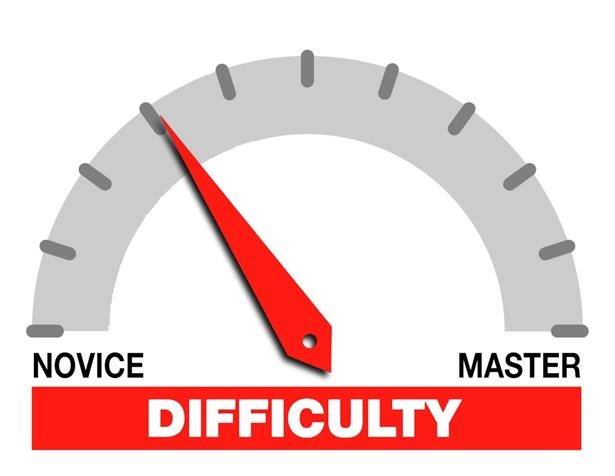

*Between Mountains and Sea*

For me, nature is not something far away. It is a place where I can go, one step at a time. Each of my hobbies brings me closer to it, and each one has taught me something important about life.

My first hobby was fishing. I started when I was a child, with a simple rod and a lot of patience. I remember waiting for a long time on the shore, watching the water and hoping to feel a small movement on the line. Later, I discovered spearfishing, and today I enjoy both. Under the water, everything is quiet, and I have to stay calm and control my breathing. Fishing taught me to wait, to stay focused, and to respect the sea. When I am on the shore or in the water, I feel free and very close to nature.

My love for the mountains started in the Atlas Mountains, where my grandparents live. When I visit them, I leave the noise of the city and enter a calm and peaceful world. I walk on small paths between the villages, I smell the earth after the rain, and I enjoy the silence. In their village, time moves slowly, and I always go back home feeling more relaxed.

Later, I decided to climb Toubkal, the highest mountain in North Africa. It was not easy. My legs were tired, it was hard to breathe, and many times I wanted to stop. But I kept going, one step after another. At the top, I saw mountains everywhere around me, and I felt very proud. That day, I learned that big goals are reached with small steps, and that I am stronger than I think.

Running gives me the same feeling. When I put on my shoes and start running, my mind becomes clear. It also helps me stay in good shape for hiking and fishing. Running keeps me disciplined, and it keeps me close to nature, early in the morning on a quiet road or on a path in the hills.

Traveling connects all of these passions. I have traveled a lot in Morocco, and I have visited almost all the beaches on both coasts, the Atlantic and the Mediterranean. Every trip gave me new places to discover and new waters to fish in. What I like the most is seeing the beach and the mountains together. They look very different, but they are both part of the same country, and for me, this is the most beautiful view.

Fishing, hiking, running, and traveling have changed the way I see life. They taught me to be patient, to stay curious, and to never give up, because the best things come after hard work.
