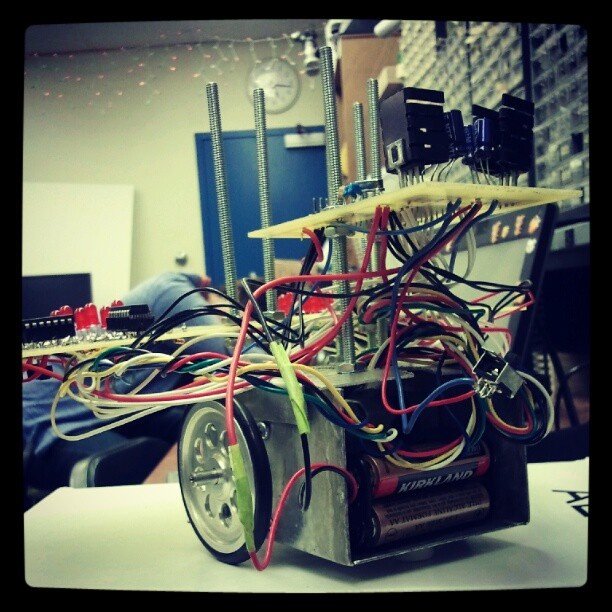
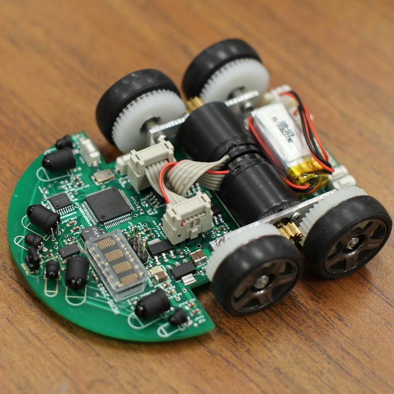
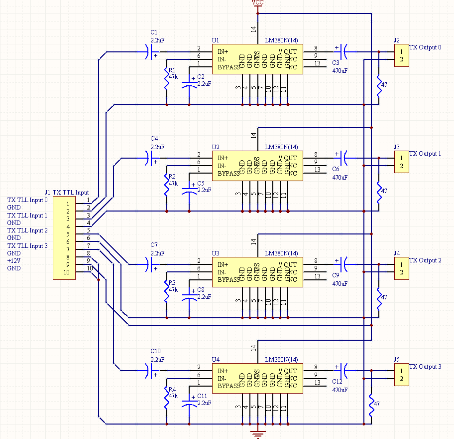

<div class="text-center p-4">
  
  
  
</div>

As part of my TIPE project in preparatory classes, I chose to model a piezoelectric membrane micropump. My goal was to prove that this type of pump is more energy-efficient than conventional mechanical systems driven by motor rotation (such as slider-crank, lead screw, or rack and pinion mechanisms). Furthermore, the displacement of the membrane allows for energy harvesting by using additional piezoelectric membranes. My Engineering Science teacher was incredibly helpful, especially on the technical side with SolidWorks and MATLAB-Simulink, but all the core ideas and initiatives were entirely my own. Fortunately, my project stood out as exceptional because it bridges the gap between biomedical applications and pure engineering, specifically fluid mechanics and design.
```
